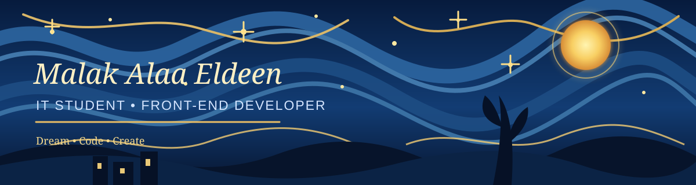

<!-- Starry Night inspired profile README -->

  

  <h3>✨ Welcome to my little corner of GitHub ✨</h3>
  
<i>Dream • Code • Create</i>

---

## 🌙 About Me

Hi! I'm **Malak**, a third-year Information Technology student at the Faculty of Computers and Artificial Intelligence, Cairo University.

- 🎓 IT student at FCAI-CU
- 💻 Interested in Front-End Development and building interactive web applications
- 🌱 Currently learning Vue.js and modern web technologies
- ✨ Always exploring new ideas and improving my skills

## 💫 Technologies & Tools

  

## 🌌 GitHub Overview

  
  

  

## ⭐ Featured Projects

  
  
  
  

## 🌠 Let's Connect

  
  
  

   
  <i>“Keep looking up at the stars, and not down at your feet.”</i>
   
  Thanks for visiting! 💙

