  

  
  
  
  

  

## `> whoami`

Student passionate about web development and problem solving.

Currently building my frontend foundations (HTML, CSS, JavaScript, then React) while studying Data Structures.

My goal is to turn what I learn into real projects and grow into a frontend developer.

## `> tech_stack`

  

## `> areas_of_interest`

  
  
  
  
  

## `> featured_projects`

  

Explore my repositories to discover my projects, experiments, and progress in web development.

## `> github_stats`

  
  

## `> connect_with_me`

  
  

  

---

  

<code>01001101 01000001 01001100 01000001 01001011</code>

<b>Create something beautiful.</b>

<i>"I dream my painting, and then I paint my dream." — Van Gogh</i>

